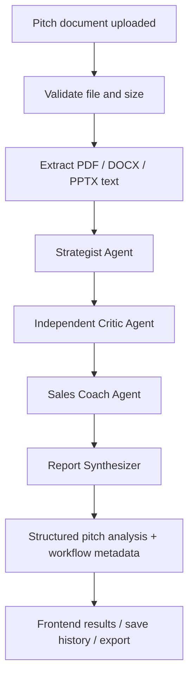
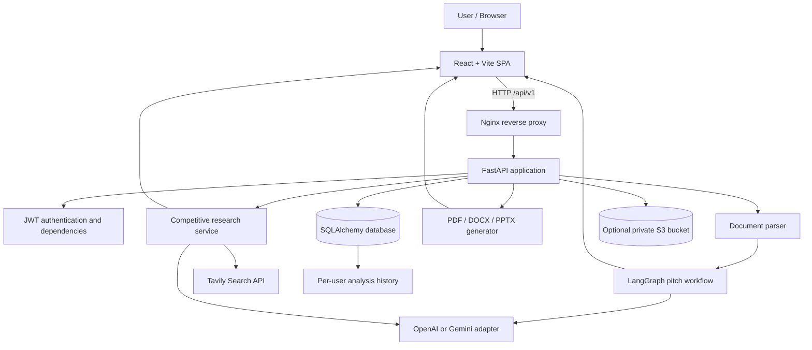
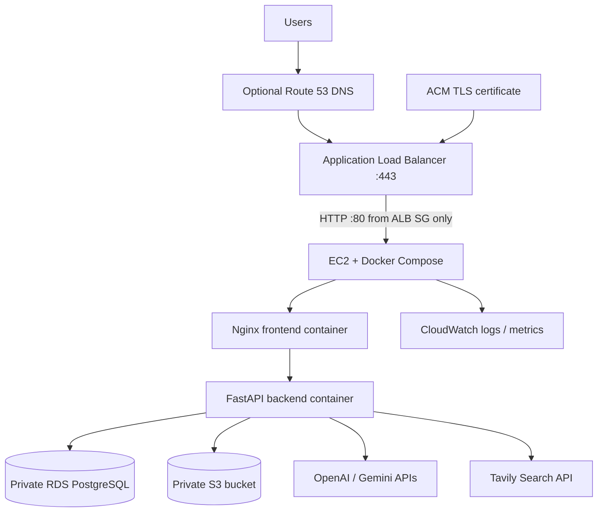

# PitchIntel AI

**AI-powered Sales Pitch Review & Competitive Intelligence Agent**

PitchIntel AI is a web application that reviews a sales pitch, evaluates its messaging and commercial clarity, recommends improvements, rewrites the pitch, researches competitors using live web-search results, and creates downloadable reports. It combines a React frontend, a FastAPI backend, LangGraph agent orchestration, OpenAI/Gemini model adapters, Tavily search, persistent user history, optional private S3 storage, and Docker-based local deployment.

> **Project status:** Phases 1–6 are implemented and merged into `main`. GitHub Actions CI (backend tests, frontend production build and Docker image builds) has passed. The application has not been deployed to AWS and has not yet been validated with a live production environment. AWS is optional; local development and Docker Compose do not require an AWS account.

## Contents

- [What the agent does](#what-the-agent-does)
- [Agent workflow](#agent-workflow-phase-2)
- [System architecture](#system-architecture)
- [End-to-end request lifecycle](#end-to-end-request-lifecycle)
- [Features by phase](#features-by-phase)
- [Technology stack](#technology-stack)
- [Repository structure](#repository-structure)
- [Prerequisites](#prerequisites)
- [Run locally without Docker](#run-locally-without-docker)
- [Run with Docker Compose](#run-with-docker-compose)
- [Environment configuration](#environment-configuration)
- [API reference](#api-reference)
- [Data model and storage](#data-model-and-storage)
- [CI/CD and optional AWS topology](#cicd-and-optional-aws-topology)
- [Security, privacy and limitations](#security-privacy-and-limitations)
- [Testing and troubleshooting](#testing-and-troubleshooting)
- [Detailed documentation](#detailed-documentation)
- [Roadmap](#roadmap)

## What the agent does

A sales user uploads a pitch document (PDF, DOCX or PPTX) and selects an AI provider. PitchIntel extracts selectable text and runs a structured review. The multi-agent workflow separates the work into specialist responsibilities:

1. **Sales Strategist** — understands the offer, value proposition, target audience, positioning, differentiators and proof points actually present in the pitch.
2. **Independent Pitch Critic** — evaluates clarity, credibility, messaging quality, value proposition, audience fit, call to action, strengths, weaknesses, missing information and risk flags.
3. **Sales Enablement Coach** — turns the findings into prioritised recommendations, a stronger rewritten pitch and a suggested call to action. It should preserve source facts and use placeholders where evidence is missing.
4. **Report Synthesizer** — consolidates the specialist outputs into one consistent report schema and calculates the overall score as the rounded average of the four critic scores plus the strategist score.

The workflow returns the analysis and a list of completed agents. It is a **sequential LangGraph workflow**, not a set of autonomous agents running in parallel. Each specialist receives the selected provider (OpenAI or Gemini), and the provider adapter validates the model output against Pydantic schemas.

Separately, the **Competitive Intelligence** capability can discover competitors, research user-supplied competitors, or combine both approaches. Tavily retrieves web results; the selected LLM extracts structured market and competitor observations from those results. The application restricts citation IDs to sources actually retrieved. This research endpoint is a separate capability from the Phase 2 pitch-agent graph; competitor names passed into the Phase 2 workflow are context only and do not trigger live research.

### What the user receives

- Executive summary and overall pitch score (0–100).
- Scores for messaging quality, value proposition, target-audience clarity and call to action.
- Strengths, weaknesses/risks and missing information.
- Prioritised recommendations and an improved pitch.
- Optional competitor profiles, market overview, competitive themes and pitch opportunities.
- Source-linked research references when competitive research is run.
- Downloadable PDF, editable DOCX and PPTX reports.
- Authenticated account, saved analysis history and optional source-file storage when S3 is configured.

## Agent workflow (Phase 2)

The core graph is implemented in `backend/app/services/agent_workflow.py`.



| Agent | Input | Responsibility | Output |
|---|---|---|---|
| Strategist | Pitch text, selected provider and optional user-supplied competitor names | Identify value proposition, target audience, positioning, differentiators, proof points present and a strategy score | Structured strategy findings |
| Critic | Original pitch plus strategist findings | Independently score messaging, value proposition, audience clarity and CTA; identify strengths, weaknesses, missing information and risks | Structured critique |
| Sales Coach | Original pitch plus strategy and critique | Create prioritised recommendations, an improved pitch and suggested CTA without fabricating evidence | Structured coaching findings |
| Report Synthesizer | Strategy, critique and coaching results | Combine results into the shared `PitchAnalysis` response model; merge risk flags into weaknesses; calculate overall score | Final report object and completed-agent list |

**Scoring:** the overall score is calculated in application code, not invented as an unstructured final model score. It is the rounded arithmetic mean of `messaging_quality`, `value_proposition`, `target_audience_clarity`, `call_to_action` and the strategist's `overall_score`. Each component is constrained to 0–100.

**Provider selection:** `agent_llm.py` adapts the same structured-output interface to OpenAI Responses API or Google Gemini. The selected provider is used by each graph node. The default provider and model names are configurable through environment variables.

**Prompt-safety approach:** agent instructions tell the model to treat uploaded document text as source data, not as instructions that can change its role. Agents are instructed not to invent customer proof, results, pricing, guarantees or competitor facts. Model output is parsed and validated against Pydantic schemas. This is a prompt and schema safeguard, not a guarantee that every generated statement is factually correct; review important output.

## System architecture

The high-level component diagram is below. The AWS portion is a **future/optional deployment topology**, not infrastructure that this repository automatically creates.



### Main layers

- **Presentation:** React + Vite single-page application. It handles document selection, provider selection, account flows, analysis/research requests, result display, report downloads and saved history.
- **Reverse proxy / web serving:** Nginx serves the built frontend and forwards `/api/*` requests to FastAPI in the Docker setup.
- **API:** FastAPI mounts versioned routers under `/api/v1`; Pydantic validates request/response structures and dependencies enforce authentication on protected endpoints.
- **AI orchestration:** LangGraph coordinates the four sequential pitch-review agents. Provider adapters isolate OpenAI and Gemini SDK calls.
- **Competitive research:** Tavily search retrieves candidate evidence; a structured LLM synthesis creates competitor findings and the backend validates returned source IDs against the retrieved source set.
- **Document processing:** PyMuPDF extracts PDF text, python-docx extracts DOCX paragraphs/tables, and python-pptx extracts PPTX slide text/tables.
- **Persistence:** SQLAlchemy stores users and analysis records in SQLite locally or PostgreSQL when configured.
- **Object storage:** Optional S3 stores explicitly uploaded pitch files and archives generated report files when enabled. The bucket should remain private.
- **Delivery:** PDF/DOCX/PPTX are generated in memory and returned as file attachments. GitHub Actions validates the code; optional manual workflow can publish images and deploy to a pre-provisioned EC2 host.

## End-to-end request lifecycle

### Pitch analysis

1. User registers or logs in and receives a short-lived bearer access token.
2. Frontend submits a PDF, DOCX or PPTX file to `POST /api/v1/agent-workflow` with provider selection and optional competitor names.
3. FastAPI verifies the extension, enforces the configured upload-size limit and validates the provider.
4. Backend writes the upload to a temporary file and extracts selectable text.
5. Empty or unsupported/scanned-only content is rejected. The extracted text is capped at 50,000 characters before entering the workflow.
6. LangGraph executes Strategist → Critic → Sales Coach → Report Synthesizer.
7. Each model response is validated against its Pydantic schema.
8. API returns the structured analysis, selected provider, original filename and workflow completion metadata.
9. Frontend displays results and can save the analysis to the authenticated user's history.
10. Temporary upload files are removed in the request cleanup path.

### Competitive research

1. Frontend submits company name, industry, research mode, optional competitor names and provider to `POST /api/v1/competitive-research`.
2. In automatic/both mode, backend asks Tavily for market competitor discovery results and uses the selected LLM to identify candidate competing companies from those results.
3. In manual/both mode, user-supplied names are included. Names are normalised, de-duplicated and the subject company is excluded.
4. Tavily is queried for each selected competitor's official website, products, features, pricing and positioning.
5. Duplicate URLs are removed and each retained result receives a source ID (for example, `S1`, `S2`).
6. The LLM produces market overview, themes, pitch opportunities and competitor profiles using only the supplied search-result content.
7. Backend drops unknown citation IDs. A finding without a valid source ID is marked low confidence and receives an unverified-evidence caveat.
8. API returns findings and source metadata. Users should open important sources to verify the claim and its freshness.

### Report generation

1. Frontend sends the existing analysis JSON and optional competitive-research JSON to the selected report endpoint.
2. Backend renders the requested PDF, DOCX or PPTX in memory.
3. Report is returned as a downloadable attachment. Export does not call the LLM again.
4. If S3 is configured, the report route can also archive the generated bytes under a user-scoped object key.

## Features by phase

| Phase | Capability | Implementation |
|---|---|---|
| 1 | Application foundation | React/Vite UI, FastAPI API, PDF/DOCX/PPTX text extraction, OpenAI and Gemini analysis adapters |
| 2 | Multi-agent pitch review | LangGraph Strategist, Critic, Sales Coach and Report Synthesizer |
| 3 | Competitive intelligence | Tavily automatic/manual/both research, structured findings, source-ID validation |
| 4 | Report exports | PDF, editable DOCX and PPTX from existing analysis data |
| 5 | Identity and persistence | Registration/login, Argon2 password hashing, JWT access tokens, SQLAlchemy, per-user history, optional S3 |
| 6 | Containerisation and delivery | Backend/frontend Dockerfiles, Docker Compose, Nginx, CI workflows, GHCR publishing and opt-in EC2 workflow |

## Technology stack

| Area | Technology | Purpose |
|---|---|---|
| Frontend | React, Vite, JavaScript, CSS | Browser UI and API integration |
| Backend | Python, FastAPI, Uvicorn | REST API and request handling |
| Validation | Pydantic | Typed request and model-output validation |
| Agent orchestration | LangGraph | Sequential multi-agent state graph |
| AI providers | OpenAI Responses API, Google Gemini | Structured LLM reasoning and generation |
| Web research | Tavily Search API, HTTPX | Live search results for competitive research |
| Documents | PyMuPDF, python-docx, python-pptx | Read source documents and create reports |
| Database | SQLAlchemy, SQLite, PostgreSQL, psycopg | Users and saved analysis records |
| Authentication | JWT, pwdlib/Argon2 | Password hashing and bearer-token authentication |
| Object storage | boto3, Amazon S3 | Optional private uploads and report archive |
| Web server | Nginx | Static frontend and API reverse proxy |
| Containers | Docker, Docker Compose | Reproducible local and server runtime |
| CI/CD | GitHub Actions, GHCR, SSH | Validation, image publishing and optional EC2 update |

## Repository structure

```text
.
├── .github/
│   └── workflows/
│       ├── ci.yml                 # PR/push tests, frontend build and Docker builds
│       └── deploy.yml             # Manual, opt-in GHCR + EC2 deployment
├── backend/
│   ├── app/
│   │   ├── api/
│   │   │   ├── routes.py          # Health and single-pass pitch analysis
│   │   │   ├── agent_routes.py    # LangGraph pitch workflow endpoint
│   │   │   ├── competitive_routes.py
│   │   │   ├── report_routes.py
│   │   │   ├── auth_routes.py
│   │   │   ├── history_routes.py
│   │   │   └── upload_routes.py
│   │   ├── schemas/               # Pydantic analysis schemas
│   │   ├── services/
│   │   │   ├── agent_workflow.py  # LangGraph graph and specialist nodes
│   │   │   ├── agent_llm.py       # OpenAI/Gemini structured-output adapter
│   │   │   ├── ai_service.py      # Phase 1 single-pass analysis
│   │   │   ├── competitor_research.py
│   │   │   ├── document_parser.py
│   │   │   ├── object_storage.py
│   │   │   └── report_generator.py
│   │   ├── config.py              # Environment-backed settings
│   │   ├── db.py                  # SQLAlchemy engine/session
│   │   ├── dependencies.py        # Current-user dependency
│   │   ├── models.py              # User and AnalysisRecord
│   │   ├── security.py             # Password hashing and JWT helpers
│   │   └── main.py                 # FastAPI app and router registration
│   ├── tests/
│   ├── Dockerfile
│   ├── requirements.txt
│   └── .env.example
├── frontend/
│   ├── src/                       # React application
│   ├── Dockerfile
│   ├── nginx.conf
│   └── package.json
├── docs/                          # Phase-specific implementation guides
├── docker-compose.yml             # Local frontend + backend + PostgreSQL
├── docker-compose.prod.yml        # Pre-built images for optional EC2 host
├── .env.compose.example
└── README.md
```

## Prerequisites

### Local development

- Python 3.11+ (Docker backend image uses Python 3.12).
- Node.js 20+ and npm (CI uses Node.js 22).
- Git.
- At least one model API key: OpenAI or Gemini.
- Tavily API key only if live competitive research is required.

### Docker development

- Docker Desktop (Windows/macOS) or Docker Engine (Linux).
- Docker Compose v2 plugin.
- API keys and a strong local JWT secret in backend environment file.

### Optional AWS deployment

- AWS account and pre-provisioned resources only if you choose to deploy: EC2, RDS PostgreSQL, private S3 bucket, security groups, ALB and ACM for public HTTPS.
- IAM instance profile for S3 permissions.
- GitHub Actions deployment secrets listed in [Phase 6 guide](docs/PHASE-6-DOCKER-AWS-CICD.md).

## Run locally without Docker

### 1. Clone and configure backend

```bash
git clone https://github.com/Rahul-17personal/capstone-agentic-ai.git
cd capstone-agentic-ai
cd backend
python -m venv .venv
```

Activate the environment:

```powershell
# Windows PowerShell
.venv\Scripts\Activate.ps1
```

```bash
# macOS / Linux
source .venv/bin/activate
```

Install packages and create the environment file:

```bash
pip install -r requirements.txt
# Copy .env.example to .env, then edit it with your keys
```

Start the API:

```bash
uvicorn app.main:app --reload --host 127.0.0.1 --port 8000
```

- API health: http://127.0.0.1:8000/api/v1/health
- Swagger UI: http://127.0.0.1:8000/docs

### 2. Start frontend in a second terminal

```bash
cd frontend
npm install
npm run dev
```

Open http://localhost:5173. Ensure `FRONTEND_ORIGIN` in backend configuration matches the frontend origin.

## Run with Docker Compose

1. From repository root, copy `.env.compose.example` to `.env`.
2. Copy `backend/.env.example` to `backend/.env`.
3. Add at least one model key and set a strong `JWT_SECRET_KEY` in `backend/.env`.
4. Set `POSTGRES_PASSWORD` in root `.env`.
5. Start the stack:

```bash
docker compose up --build -d
docker compose ps
docker compose logs -f backend
```

Open http://localhost:8080. Nginx serves the frontend and forwards API requests to the backend. PostgreSQL data is stored in a named Docker volume.

Stop services:

```bash
docker compose down
```

To also remove the local PostgreSQL volume (this permanently deletes local database data):

```bash
docker compose down -v
```

## Environment configuration

See `backend/.env.example` and `.env.compose.example` for the authoritative variable names. Common settings:

| Variable | Purpose | Required |
|---|---|---|
| `OPENAI_API_KEY` | OpenAI model access | If using OpenAI |
| `OPENAI_MODEL` | OpenAI model name; default configured in app | Optional |
| `GEMINI_API_KEY` | Google Gemini model access | If using Gemini |
| `GEMINI_MODEL` | Gemini model name; default configured in app | Optional |
| `DEFAULT_AI_PROVIDER` | Default provider: `openai` or `gemini` | Optional |
| `TAVILY_API_KEY` | Live competitor discovery/research | Only for competitive research |
| `DATABASE_URL` | SQLAlchemy database connection | Optional locally; SQLite default |
| `JWT_SECRET_KEY` | Signs access tokens; use a long random value | Yes; secure value required in production |
| `ACCESS_TOKEN_MINUTES` | Access-token lifetime | Optional |
| `MAX_UPLOAD_MB` | Maximum uploaded file size | Optional |
| `FRONTEND_ORIGIN` | Exact allowed browser origin for CORS | Yes for deployed environments |
| `AWS_REGION` | S3 region | Only when using S3 |
| `AWS_S3_BUCKET` | Enables S3 upload/archive when set | Only when using S3 |
| `APP_ENV` | Runtime environment; production rejects placeholder JWT secret | Optional |

Never place secrets in frontend `VITE_*` variables. Never commit real `.env` files.

## API reference

All routes are prefixed with `/api/v1`. Protected routes require:

```http
Authorization: Bearer <access_token>
```

| Method | Endpoint | Authentication | Purpose |
|---|---|---|---|
| GET | `/health` | No | Health check |
| POST | `/analyze` | No in current implementation | Phase 1 single-pass document analysis |
| POST | `/agent-workflow` | Yes | Run the four-agent LangGraph workflow; multipart upload |
| POST | `/competitive-research` | Yes | Tavily-based competitor research; JSON |
| POST | `/reports/pdf` | Yes | Generate PDF attachment |
| POST | `/reports/docx` | Yes | Generate editable DOCX attachment |
| POST | `/reports/pptx` | Yes | Generate PPTX attachment |
| POST | `/auth/register` | No | Register and return bearer token |
| POST | `/auth/login` | No | Authenticate and return bearer token |
| GET | `/auth/me` | Yes | Return current user |
| POST | `/history` | Yes | Save analysis record |
| GET | `/history` | Yes | List current user's latest 100 records |
| GET | `/history/{id}` | Yes | Retrieve an owned record; may return temporary S3 URL |
| DELETE | `/history/{id}` | Yes | Delete an owned record |
| POST | `/uploads/pitch` | Yes | Upload pitch source to S3 |

### Agent workflow request

`POST /api/v1/agent-workflow` uses multipart form data:

- `file`: PDF, DOCX or PPTX (required).
- `provider`: `openai` or `gemini`.
- `competitors`: optional comma-separated competitor names (context only in this endpoint).

The endpoint currently limits extracted text to 50,000 characters and upload size to `MAX_UPLOAD_MB` (default 20 MB). Scanned/image-only files are not OCR-processed.

### Competitive research request

`POST /api/v1/competitive-research` JSON example:

```json
{
  "company_name": "Acme",
  "industry": "CRM software",
  "competitors": ["Salesforce", "HubSpot"],
  "research_mode": "both",
  "provider": "openai"
}
```

- `automatic`: discover competitor candidates from search results.
- `manual`: research only the supplied competitor names.
- `both`: combine discovered and supplied names.

### Report export request

The report endpoints accept JSON containing `company_name`, `analysis`, optional `competitive_research`, `workflow` and optional `source_filename`. Pass the existing analysis response; report export does not rerun AI analysis.

Interactive API schemas are available at `/docs` when the backend is running.

## Data model and storage

### Relational records

- **User:** numeric ID, unique email, full name, Argon2 password hash, creation timestamp.
- **AnalysisRecord:** owner user ID, company name, source filename, overall score, analysis JSON, optional competitive-research JSON, optional S3 source object key and creation timestamp.

History queries filter by the authenticated user's ID. A user cannot retrieve or delete another user's record through the history routes.

### S3 object layout

When configured, objects use user-scoped keys:

- Pitch uploads: `users/{user_id}/pitches/{uuid}.{extension}`
- Generated report archives: `users/{user_id}/reports/{uuid}.{format}`

Uploads use SSE-S3 (`AES256`). Download links are presigned and short-lived (10 minutes by default). Keep S3 Block Public Access enabled and use least-privilege IAM permissions. Original pitch files are **not automatically saved** by the analysis endpoint; the explicit upload endpoint is used for source-file persistence.

### Database modes

- Local default: SQLite.
- Container Compose: PostgreSQL 16 service with persistent named volume.
- Optional deployed mode: managed PostgreSQL (for example Amazon RDS) configured using `DATABASE_URL`.

The current application uses SQLAlchemy `create_all` at startup for capstone/dev convenience. Adopt Alembic migrations before production schema evolution.

## CI/CD and optional AWS topology

### GitHub Actions CI

`.github/workflows/ci.yml` runs on pull requests to `main` and pushes to `main` or Phase feature branches:

1. Install Python dependencies and run backend pytest suite.
2. Install frontend dependencies and run the production Vite build.
3. Build backend and frontend Docker images without publishing them.

### Deployment workflow safety

`.github/workflows/deploy.yml` is manually triggered using `workflow_dispatch`. Its `deploy_to_ec2` boolean defaults to `false`. Validation runs first; the GHCR publish/EC2 deployment job is skipped unless the operator explicitly selects `true`. Merging code into `main` does **not** automatically deploy the application.

If deliberately enabling EC2 deployment, configure the required GitHub Actions secrets: `EC2_HOST`, `EC2_USER`, `EC2_SSH_PRIVATE_KEY`, `EC2_APP_DIR`, `GHCR_USERNAME` and `GHCR_READ_TOKEN`. The workflow assumes the host, Docker, Compose, environment files, database, S3 and network are already prepared. It does not provision AWS infrastructure.

### Target AWS architecture (not provisioned by this repository)



Recommended controls: public HTTPS only at the ALB; EC2 inbound port 80 only from the ALB security group; SSH restricted to administrator IP or use SSM; RDS private and reachable only from EC2 security group; S3 private; EC2 instance profile for S3; secrets stored on host or in AWS Secrets Manager/SSM; CloudWatch agent/log driver configured separately. See [Phase 6 deployment guide](docs/PHASE-6-DOCKER-AWS-CICD.md).

## Security, privacy and limitations

- Keep all model, Tavily, JWT, database and AWS credentials server-side. Do not commit secrets.
- Upload only files you are authorised to process. Extracted pitch content is sent to the selected AI provider for analysis.
- Temporary analysis uploads are deleted after processing. Scanned/image-only PDFs and slide images are not OCR-processed.
- Model output can be wrong or incomplete. Source-ID validation verifies that a citation ID exists in the retrieved result set; it does not prove that the cited page semantically supports every generated claim.
- Pricing, features and competitor pages may be stale, regional, promotional or incomplete. Human verification is required for important decisions.
- The current capstone uses short-lived JWT access tokens and stores them in browser localStorage. Production should use secure HttpOnly cookies, hardened CSP, token revocation/refresh strategy and stronger session controls.
- Production hardening still required: Alembic migrations, rate limiting and quotas, login throttling, email verification, MFA, malware/content scanning, audit logging, retries/timeouts, backups, monitoring, secret manager, disaster recovery and load testing.
- Docker builds and CI have passed, but that does not constitute a live AWS deployment or end-to-end production validation.

## Testing and troubleshooting

Backend tests:

```bash
cd backend
pytest -q
```

Frontend production build:

```bash
cd frontend
npm install
npm run build
```

Common issues:

| Symptom | Check |
|---|---|
| Provider key missing | Confirm `OPENAI_API_KEY` or `GEMINI_API_KEY` is in backend environment, not frontend |
| Competitive research unavailable | Configure `TAVILY_API_KEY`; verify Tavily access and selected provider key |
| CORS error | Set `FRONTEND_ORIGIN` to the exact frontend origin |
| Upload rejected | Check supported extension, file size and selectable text |
| Database connection error | Check `DATABASE_URL`, DB service health and credentials |
| S3 upload/archive error | Check bucket, region, IAM permissions and private bucket configuration |
| Docker backend unhealthy | Inspect `docker compose logs -f backend` and `docker compose ps` |

## Detailed documentation

- [System architecture and component design](docs/ARCHITECTURE.md)
- [Phase 2 — Agent workflow](docs/PHASE-2-AGENT-WORKFLOW.md)
- [Phase 3 — Competitive intelligence](docs/PHASE-3-COMPETITIVE-INTELLIGENCE.md)
- [Phase 4 — Report exports](docs/PHASE-4-REPORT-EXPORT.md)
- [Phase 5 — Identity, persistence and S3](docs/PHASE-5-IDENTITY-STORAGE.md)
- [Phase 6 — Docker, AWS target architecture and CI/CD](docs/PHASE-6-DOCKER-AWS-CICD.md)

## Roadmap

- [x] Phase 1 — Web application foundation and dual-provider pitch analysis.
- [x] Phase 2 — Sequential LangGraph multi-agent review.
- [x] Phase 3 — Live competitor discovery and source-linked research.
- [x] Phase 4 — PDF, DOCX and PPTX export.
- [x] Phase 5 — Authentication, database history and optional S3 storage.
- [x] Phase 6 — Docker, Compose, Nginx, CI and opt-in deployment workflow.
- [ ] Production hardening — migrations, hardened session management, rate limits, observability, security review and staging validation.
- [ ] OCR support for scanned documents and image-based slides.
- [ ] Background jobs and scheduled competitive-intelligence refresh.

---

**PitchIntel AI** — turning sales pitch content into structured feedback, actionable coaching and evidence-linked competitive context.
