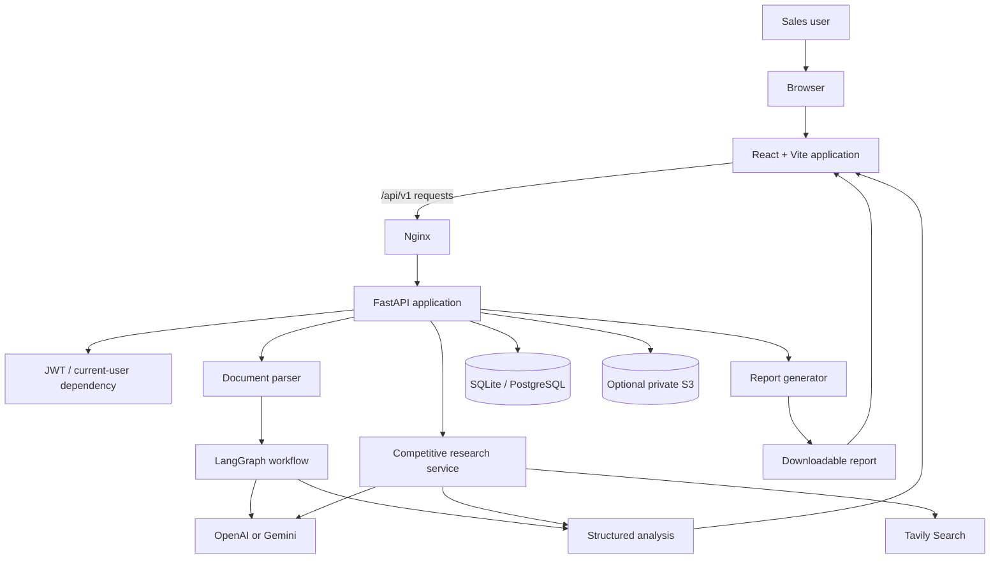
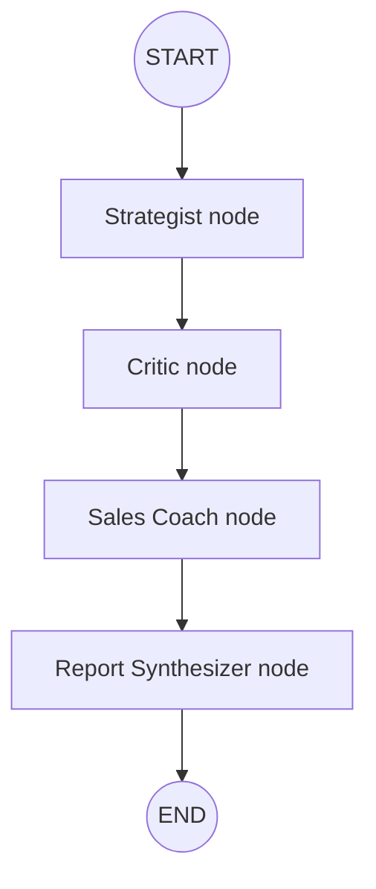
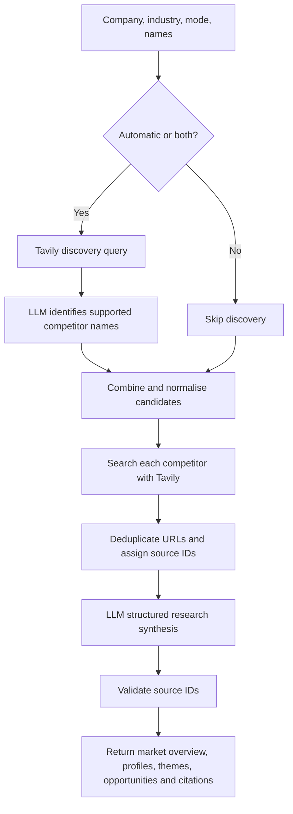
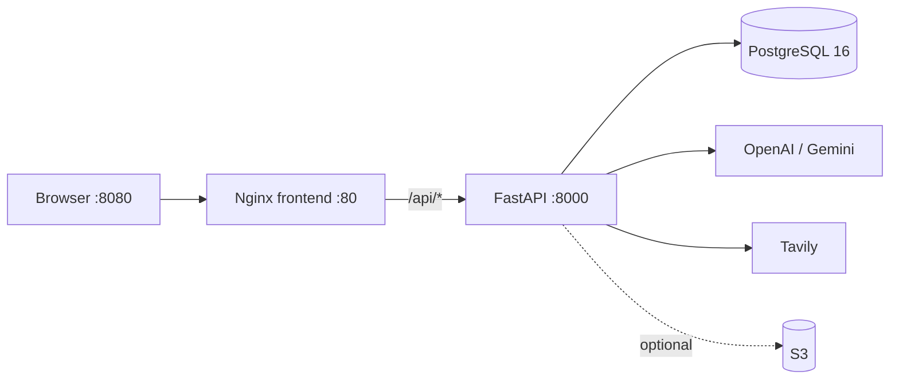
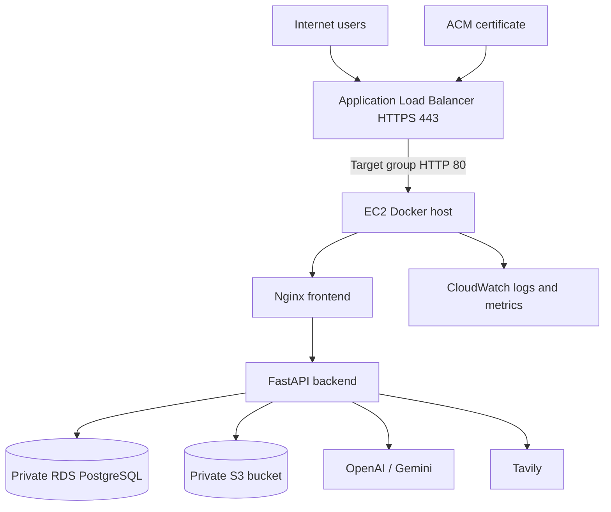

# PitchIntel AI — System Architecture & Technical Design

This document describes the current implementation in the repository. It distinguishes implemented application behavior from the optional AWS target topology. It is intended as a technical companion to the root README.

## 1. Product purpose

PitchIntel AI helps a sales professional evaluate a pitch document and turn the findings into practical improvements. It combines:

- Document text extraction.
- A sequential multi-agent sales-pitch review workflow.
- OpenAI and Google Gemini structured-output adapters.
- Optional live competitor discovery and research through Tavily.
- Downloadable PDF, DOCX and PPTX reports.
- User registration, authentication and per-user analysis history.
- Optional private S3 upload and report archival.
- Docker packaging, local Compose and GitHub Actions CI.

The application is a capstone implementation. It is not an autonomous system that can contact prospects, change a CRM, send emails, negotiate prices or execute sales actions. Its role is analysis, research synthesis, coaching and report generation.

## 2. Context and high-level architecture



### Trust boundaries

1. The browser is an untrusted client. It must not contain provider, Tavily, database or AWS credentials.
2. FastAPI is the application boundary. It validates inputs, applies authentication dependencies to protected endpoints and calls service modules.
3. Uploaded documents and retrieved web snippets are untrusted content. Prompts explicitly instruct the models to treat these as source material, not instructions.
4. OpenAI, Gemini and Tavily are external services. Their availability, latency, output and usage costs are outside the application's control.
5. The database and S3 bucket are persistence boundaries. In a deployed environment they should be private and accessible only to the application identity/network.

## 3. Frontend and API gateway

### Frontend

The React/Vite SPA is in `frontend/`. Its responsibilities include:

- Presenting the analysis workflow and accepting PDF, DOCX and PPTX documents.
- Allowing the user to select OpenAI or Gemini.
- Sending the uploaded file and form fields to FastAPI.
- Displaying structured analysis and workflow results.
- Calling the competitive-research capability with company, industry, competitor list, research mode and provider.
- Offering report downloads.
- Supporting registration, login, sign-out and saved analysis history.

### Nginx

The frontend Docker image builds the Vite application and serves its static output with Nginx. Nginx also reverse-proxies API requests to the backend service. In Docker Compose, the browser uses port 8080 and the frontend container listens on port 80. The backend listens on port 8000 inside the Compose network and is not directly published to the host by the base Compose file.

### FastAPI application

The application entry point is `backend/app/main.py`. It:

- Creates the FastAPI application and metadata/version.
- Checks that production is not using the development placeholder JWT secret.
- Creates SQLAlchemy tables at startup for this capstone setup.
- Configures CORS for the configured frontend origin.
- Registers the API routers under `/api/v1`.

Interactive API documentation is available at `/docs` while the backend is running.

## 4. Pitch review agent system

### Graph topology

The graph is implemented in `backend/app/services/agent_workflow.py` using LangGraph `StateGraph`.



The edges are fixed and sequential. The workflow is invoked once per request. It is not a planner/executor loop, does not spawn agents dynamically, and does not run nodes in parallel.

### Shared graph state

The typed workflow state contains:

| State key | Meaning |
|---|---|
| `pitch_text` | Extracted and truncated pitch text |
| `provider` | Selected provider: `openai` or `gemini` |
| `competitors` | Optional names supplied by the user; context only in this graph |
| `strategy` | Strategist structured output |
| `critique` | Critic structured output |
| `coaching` | Sales Coach structured output |
| `analysis` | Final shared pitch-analysis schema |
| `completed_agents` | Ordered names of completed graph nodes |

### Agent 1 — Sales Strategist

**Purpose:** establish what the pitch is trying to sell and whom it is trying to persuade.

It evaluates:
- Value proposition.
- Intended target audience.
- Market/product positioning.
- Differentiators.
- Proof points actually present in the submitted content.
- A strategy score from 0 to 100.

It must not invent proof points or competitor facts. Its output is validated against the `StrategyFinding` Pydantic model.

### Agent 2 — Independent Pitch Critic

**Purpose:** challenge the pitch rather than simply agree with the Strategist.

It receives the original pitch and the Strategist's findings. It evaluates:
- Executive summary.
- Strengths.
- Weaknesses.
- Missing information.
- Risk flags.
- Messaging quality score.
- Value proposition score.
- Target-audience clarity score.
- Call-to-action score.

All four scores are integers constrained to 0–100. The critic is instructed to distinguish missing evidence from a demonstrated weakness and not invent facts. Output is validated against `CriticFinding`.

### Agent 3 — Sales Enablement Coach

**Purpose:** translate the assessment into usable sales improvements.

It receives the original pitch, strategy findings and critique. It returns:
- Prioritised recommendations.
- An improved/re-written pitch.
- A suggested call to action.

It is instructed to preserve source facts and use explicit placeholders when proof is missing. It must not fabricate customers, results, prices or guarantees. Output is validated against `CoachingFinding`.

### Agent 4 — Report Synthesizer

**Purpose:** produce one stable report contract for the frontend, history and export services.

It:
- Uses the critic's executive summary.
- Copies strengths, missing information and scores.
- Combines critic weaknesses and risk flags into the final weaknesses list.
- Uses the coach's recommendations and improved pitch.
- Adds a competitor-context note clarifying that names supplied to this workflow were not independently researched.
- Calculates overall score as the rounded arithmetic mean of the Strategist score and the four Critic scores.

Formula:

`overall_score = round((strategist_score + messaging_quality + value_proposition + target_audience_clarity + call_to_action) / 5)`

The final object is validated through the shared `PitchAnalysis` schema. Workflow metadata reports LangGraph, completion status and the ordered completed-agent names.

### Provider adapter

`backend/app/services/agent_llm.py` implements `generate_structured(...)`:

- OpenAI path uses the Responses API with JSON output.
- Gemini path uses the Google GenAI SDK with JSON MIME type and a response schema.
- Both paths validate the returned JSON with the requested Pydantic model.
- Missing API keys, empty model responses and unsupported provider names raise errors.

The Phase 1 single-pass analysis uses `ai_service.py`; the multi-agent workflow uses `agent_llm.py`. The selected provider is supplied by the request or default configuration.

## 5. Document ingestion and validation

Implemented in `backend/app/services/document_parser.py` and the API routes.

| Format | Library | Extracted content |
|---|---|---|
| PDF | PyMuPDF | Selectable page text |
| DOCX | python-docx | Paragraphs and table cell text |
| PPTX | python-pptx | Slide text and table cell text |

The agent endpoint:
- Accepts `.pdf`, `.docx`, `.pptx`.
- Reads at most configured upload limit plus one byte to detect oversize input.
- Defaults to a 20 MB limit unless configured otherwise.
- Writes content to a temporary file for parsing.
- Rejects empty files and files with no selectable text.
- Truncates extracted pitch content to 50,000 characters before calling the graph.
- Removes the temporary file in a `finally` block and closes the upload.

**Current limitation:** scanned PDFs, image-only slides and OCR are not supported. The parser does not interpret charts, diagrams or images as visual content.

## 6. Competitive intelligence subsystem

Implemented in `backend/app/services/competitor_research.py`. It is a separate API capability and is not an automatic sub-node of the Phase 2 LangGraph graph.

### Modes

| Mode | Candidate selection |
|---|---|
| `automatic` | Discover competitors using search results |
| `manual` | Research only names supplied by the user |
| `both` | Combine discovered candidates and supplied names |

### Research sequence



### Search and synthesis details

- Automatic discovery asks Tavily for leading competitors and alternatives in the specified industry.
- The LLM is instructed to identify only companies supported by those retrieved results.
- Candidate names are normalised, de-duplicated, capped and the subject company is excluded.
- Each selected competitor receives a Tavily query for official website, products, features, pricing and positioning.
- Duplicate URLs are removed. Retained sources receive IDs such as `S1`, `S2`.
- Structured synthesis includes competitor summary, positioning, products/features, pricing observations, differentiators, strengths, limitations/gaps, confidence and caveats.
- The market-level response includes overview, competitive themes and pitch opportunities.
- Every finding's source IDs are filtered against the actual retrieved source-ID set. A finding with no valid IDs is downgraded to low confidence and marked unverified.
- Citation URLs are drawn from retrieved Tavily results; the LLM does not get to create arbitrary citation URLs in the final source list.

### Evidence limitations

Source-ID validation proves only that a source ID was in the retrieved set. It does not prove semantic entailment. Search snippets may be incomplete or stale; pricing can vary by region and plan. Important claims must be checked by a human against the linked page. Tavily and model API usage may incur costs.

## 7. Report generation

Implemented in `backend/app/services/report_generator.py` and `backend/app/api/report_routes.py`.

The report endpoints accept an existing analysis payload and optional competitive-research data. They do not rerun pitch analysis.

| Output | Library | Contents |
|---|---|---|
| PDF | ReportLab | Title, score, metric table, narrative sections, bullets, competitor findings and clickable source links |
| DOCX | python-docx | Editable headings, summary, score table, recommendations and source URLs |
| PPTX | python-pptx | Presentation slides for summary, scores, strengths, weaknesses, recommendations and competitive findings |

Files are generated in memory and streamed as attachments. If S3 is enabled, report bytes can also be archived to a user-scoped S3 key. A storage failure is surfaced by the report route rather than silently claiming archival succeeded.

## 8. Identity, authorisation and database

### Authentication

- Registration and login use email/password.
- Passwords are hashed with pwdlib's recommended Argon2 implementation.
- Successful registration/login returns a JWT bearer access token.
- JWT uses HS256 and an expiry configured by `ACCESS_TOKEN_MINUTES` (default 60).
- Protected routes use `get_current_user` to decode the token and load the user.
- The production startup check rejects the development placeholder JWT secret.

### SQLAlchemy entities

**User**
- `id`
- `email` (unique)
- `full_name`
- `password_hash`
- `created_at`
- relationship to analysis records

**AnalysisRecord**
- `id`
- `user_id` foreign key
- `company_name`
- `source_filename`
- `overall_score`
- `analysis` JSON
- `competitive_research` optional JSON
- `source_s3_key` optional
- `created_at`

History list/read/delete queries include the authenticated user's ID, enforcing record ownership at the query layer. List history returns at most the latest 100 records.

### Database configuration

- SQLite is the local default when `DATABASE_URL` is not provided.
- Docker Compose starts PostgreSQL 16 with a named data volume.
- A deployed environment can use PostgreSQL (for example RDS) through `DATABASE_URL`.

The current application calls SQLAlchemy `create_all` at startup. Use Alembic migrations for production schema changes.

## 9. S3 object storage

S3 is optional. It is enabled when `AWS_S3_BUCKET` is configured.

- Upload endpoint stores source pitches under `users/{user_id}/pitches/{uuid}.{extension}`.
- Report archive stores exports under `users/{user_id}/reports/{uuid}.{format}`.
- Uploads specify SSE-S3 encryption (`AES256`).
- History retrieval can return a presigned download URL with a default lifetime of 600 seconds.
- Application uses boto3 and the standard AWS credential chain; prefer an EC2 instance role over static access keys.
- Bucket should have Block Public Access enabled and IAM should be restricted to the required bucket/prefix and actions.

Analysis uploads are temporary and deleted after parsing. The source document is not automatically persisted unless the separate S3 upload endpoint is used.

## 10. API surface

All routes are mounted below `/api/v1`.

| Method | Route | Auth | Description |
|---|---|---|---|
| GET | `/health` | No | Service health |
| POST | `/analyze` | No in current code | Phase 1 single-pass analysis |
| POST | `/agent-workflow` | Yes | Multi-agent pitch analysis; multipart |
| POST | `/competitive-research` | Yes | Live competitor research; JSON |
| POST | `/reports/pdf` | Yes | PDF attachment |
| POST | `/reports/docx` | Yes | DOCX attachment |
| POST | `/reports/pptx` | Yes | PPTX attachment |
| POST | `/auth/register` | No | Register account |
| POST | `/auth/login` | No | Login |
| GET | `/auth/me` | Yes | Current user profile |
| POST | `/history` | Yes | Save analysis |
| GET | `/history` | Yes | List current user's history |
| GET | `/history/{record_id}` | Yes | Read an owned history record |
| DELETE | `/history/{record_id}` | Yes | Delete an owned history record |
| POST | `/uploads/pitch` | Yes | Persist pitch to S3 |

Use Swagger UI at `http://127.0.0.1:8000/docs` for exact request schemas and response models.

## 11. Runtime and deployment architecture

### Local Docker Compose



Compose services:
- `db`: PostgreSQL 16 Alpine, health check and persistent named volume.
- `backend`: Python API image, environment file, waits for database health, internal port 8000.
- `frontend`: Nginx-served production build, publishes host port 8080 and depends on backend health.

### CI pipeline

`.github/workflows/ci.yml` runs for pull requests targeting `main` and pushes to `main` or feature branches matching `feature/pitchintel-ai-phase*`.

Jobs:
1. `backend-tests`: Python 3.12, install requirements and run `pytest -q` using CI-only JWT/database values.
2. `frontend-build`: Node 22, `npm install`, `npm run build`.
3. `docker-build`: depends on backend and frontend success; builds both Docker images without publishing.

### Optional EC2 deployment workflow

The deploy workflow is manual (`workflow_dispatch`) and has boolean input `deploy_to_ec2` defaulting to `false`. Validation runs first. Image publication and EC2 SSH deployment are skipped unless the operator explicitly enables the input.

If enabled, it builds and publishes backend/frontend images to GHCR, SSHes to an already prepared EC2 host, copies the production Compose file, pulls the chosen image tag and restarts services. It assumes pre-existing host resources and secrets; it does not provision VPC, EC2, RDS, S3, ALB, ACM or security groups. A merge or push to `main` alone does not deploy.

### AWS target topology



Recommended network model:
- ALB is public and terminates TLS with ACM.
- EC2 is reachable on port 80 only from the ALB security group.
- SSH is restricted to an administrator source IP or replaced with SSM Session Manager.
- RDS is private and accepts PostgreSQL traffic only from EC2 security group.
- S3 blocks public access and is accessed with an EC2 instance profile.
- Host and backend secrets are stored outside source control, preferably in AWS Secrets Manager or SSM Parameter Store.
- CloudWatch agent or Docker log driver, alarms, backups, RDS encryption/deletion protection and rollback must be configured as separate operational tasks.

## 12. Configuration reference

| Variable | Function |
|---|---|
| `APP_NAME` | FastAPI application name |
| `APP_ENV` | Environment; production enforces non-placeholder JWT secret |
| `OPENAI_API_KEY` | OpenAI credentials |
| `OPENAI_MODEL` | OpenAI model identifier |
| `GEMINI_API_KEY` | Gemini credentials |
| `GEMINI_MODEL` | Gemini model identifier |
| `DEFAULT_AI_PROVIDER` | Default `openai` or `gemini` |
| `TAVILY_API_KEY` | Competitive research search credentials |
| `MAX_UPLOAD_MB` | Maximum upload size |
| `FRONTEND_ORIGIN` | Exact CORS browser origin |
| `DATABASE_URL` | SQLAlchemy connection string |
| `JWT_SECRET_KEY` | JWT signing secret |
| `ACCESS_TOKEN_MINUTES` | Access-token expiry |
| `AWS_REGION` | AWS region for S3 |
| `AWS_S3_BUCKET` | Enables S3 integration when set |
| `POSTGRES_PASSWORD` | Local Compose PostgreSQL password |
| `VITE_API_URL` | Frontend build-time API path (Compose uses `/api/v1`) |

See `backend/.env.example` and `.env.compose.example` for defaults and formatting.

## 13. Security and production readiness

Implemented safeguards:
- Backend-only API keys.
- Password hashing with Argon2.
- Expiring JWT bearer tokens.
- Authenticated analysis/research/report/history/upload routes.
- User-scoped history queries.
- File extension and size checks.
- Temporary-file cleanup.
- Pydantic validation for model output.
- Source-ID allow-listing for research citations.
- Optional S3 server-side encryption and short-lived presigned URLs.
- Production check for the development JWT secret.

Before production, implement or review:
- Alembic migrations and a tested schema rollout strategy.
- HttpOnly Secure SameSite cookie transport instead of localStorage token storage.
- Refresh-token/session revocation and logout invalidation.
- MFA, email verification, password reset and login throttling.
- API rate limits, quotas and per-user provider cost controls.
- Malware scanning and stricter content validation for uploaded files.
- Prompt-injection testing and stronger output/source verification.
- Request timeouts, bounded retries and background jobs for long-running research.
- Audit events, structured logs, metrics, tracing and alerting.
- Database backups, restore drills, S3 lifecycle/retention policies and disaster recovery.
- HTTPS, hardened CSP, dependency scanning, secret scanning and penetration testing.

## 14. Known limitations

- Scanned/image-only PDF and image-based slide OCR is not implemented.
- Pitch text is capped at 50,000 characters for the agent workflow.
- Phase 2 agents execute sequentially and use one model call per node.
- User-supplied competitor names in Phase 2 are context only; live research is a separate endpoint.
- Competitive research is limited to retrieved Tavily results and snippets; it is not a comprehensive market database.
- Source ID validation is not semantic fact verification.
- Report generation is synchronous and in-memory.
- S3 is optional and requires external bucket/IAM configuration.
- Production database migrations and advanced identity/session controls are not implemented.
- EC2 workflow assumes a pre-provisioned host and infrastructure; it has not been run against an AWS account in this project.
- Passing CI does not mean a live production deployment has been performed.

## 15. Local developer commands

Backend:

```bash
cd backend
python -m venv .venv
# activate virtual environment
pip install -r requirements.txt
pytest -q
uvicorn app.main:app --reload --host 127.0.0.1 --port 8000
```

Frontend:

```bash
cd frontend
npm install
npm run dev
npm run build
```

Docker:

```bash
docker compose up --build -d
docker compose ps
docker compose logs -f backend
docker compose down
```

## 16. Source map

| Concern | Main implementation |
|---|---|
| App registration / router wiring | `backend/app/main.py` |
| Phase 1 single-pass pitch analysis | `backend/app/services/ai_service.py` |
| File text extraction | `backend/app/services/document_parser.py` |
| LangGraph agents and graph | `backend/app/services/agent_workflow.py` |
| OpenAI/Gemini structured output | `backend/app/services/agent_llm.py` |
| Competitor discovery and synthesis | `backend/app/services/competitor_research.py` |
| PDF/DOCX/PPTX generation | `backend/app/services/report_generator.py` |
| Authentication endpoints | `backend/app/api/auth_routes.py` |
| History and ownership checks | `backend/app/api/history_routes.py` |
| S3 operations | `backend/app/services/object_storage.py` |
| SQLAlchemy entities | `backend/app/models.py` |
| JWT and password helpers | `backend/app/security.py` |
| Environment configuration | `backend/app/config.py` |
| Docker and reverse proxy | `Dockerfile`, `docker-compose*.yml`, `frontend/nginx.conf` |
| CI and optional deployment | `.github/workflows/*.yml` |

---

For installation and quick-start commands, see the [root README](../README.md).
